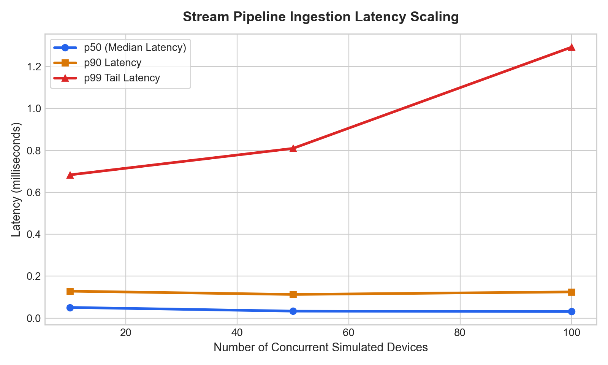
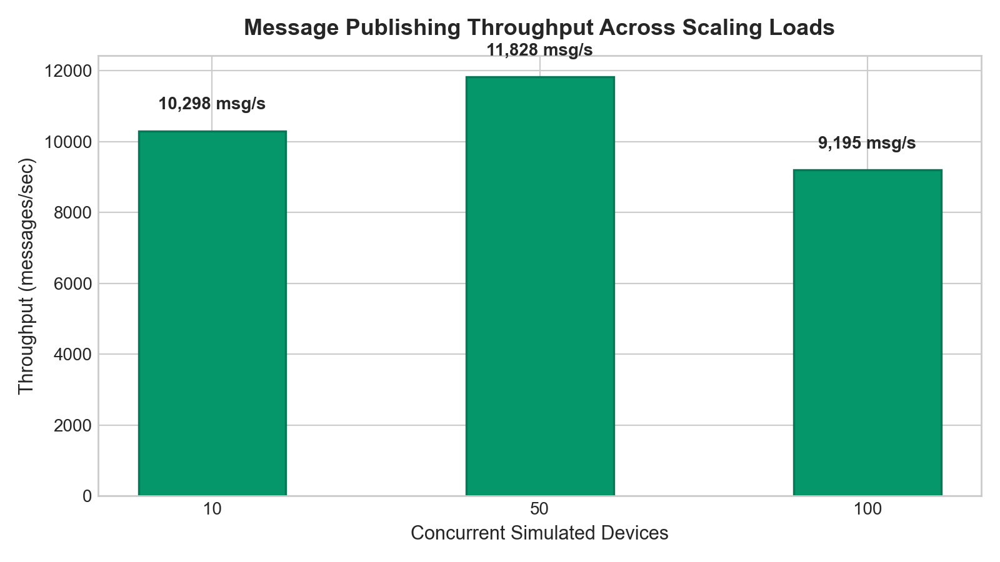
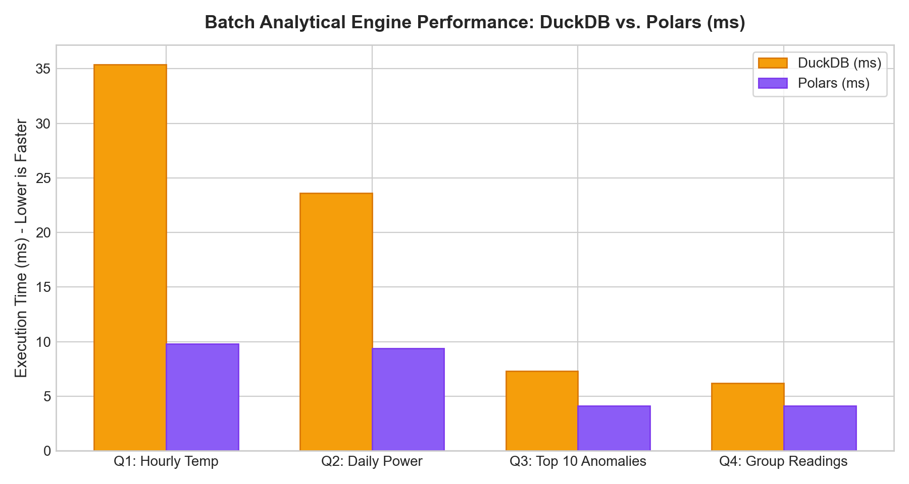

# Empirical Performance Results & Benchmark Analysis

## 1. Streaming Ingestion Throughput & Latency Distribution

| Simulated Devices | Total Events | Throughput (msg/s) | p50 (ms) | p90 (ms) | p95 (ms) | p99 (ms) | Avg (ms) |
|---|---|---|---|---|---|---|---|
| 10 | 3,000 | 10,298.3 | 0.0508 | 0.1284 | 0.2157 | 0.6835 | 0.081 |
| 50 | 3,000 | 11,828.16 | 0.0332 | 0.1128 | 0.2395 | 0.8096 | 0.0726 |
| 100 | 3,000 | 9,194.83 | 0.0312 | 0.1249 | 0.2909 | 1.2926 | 0.0973 |

## 2. Historical Batch Analytics Race (DuckDB vs Polars)

| Query | DuckDB (s) | Polars (s) | Speedup Ratio | Winner |
|---|---|---|---|---|
| Q1: Hourly Room Temp (Avg/Max) | 0.0354 | 0.0098 | 3.61x | Polars (3.61x) |
| Q2: Daily Room Power (Sum) | 0.0236 | 0.0094 | 2.49x | Polars (2.49x) |
| Q3: Top 10 Devices with Anomalies | 0.0073 | 0.0041 | 1.76x | Polars (1.76x) |
| Q4: Readings Per Device (Group-By) | 0.0062 | 0.0041 | 1.52x | Polars (1.52x) |

## 3. Fault Tolerance & Zero-Data-Loss Audit

- **Total Test Messages Produced:** 100
- **Processed Pre-Crash:** 40 events
- **Processed Post-Recovery:** 60 events
- **Missing Records (Data Loss):** 0
- **Duplicated Records:** 0
- **Audit Status:** **PASS (100% Zero Message Loss Confirmed)**
